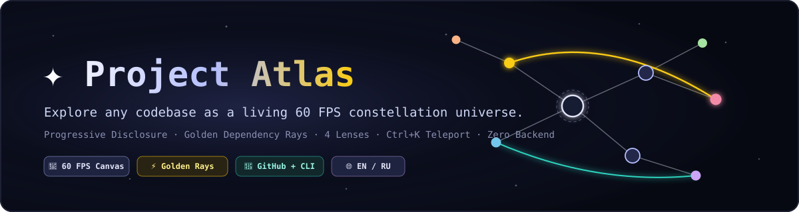
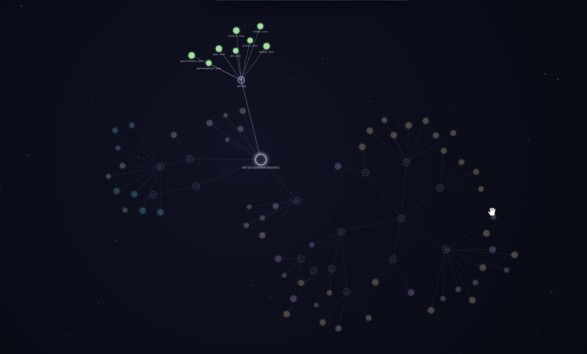

<p align="center">
  
</p>

<p align="center">
  <a href="https://goblin-inc.github.io/Project-Atlas/"></a>
  <a href="https://github.com/Goblin-Inc/Project-Atlas/releases/tag/v1.0.1"></a>
  
  
  <a href="LICENSE"></a>
</p>

<p align="center">
  <b><a href="https://goblin-inc.github.io/Project-Atlas/">🚀 Try Live Demo</a></b> ·
  <a href="README_Ru.md">🇷🇺 Русская версия</a> ·
  <a href="#-quick-start">Quick Start</a> ·
  <a href="#-4-architecture-lenses">Lenses</a>
</p>

---

**Project Atlas** turns any local folder or public GitHub repository into an interactive, **60 FPS constellation universe** — helping you understand an unfamiliar codebase in **30 seconds**.

Instead of dumping 500 overlapping nodes into an unreadable hairball, Atlas starts cleanly at the project root: expand folders organically like constellations, inspect syntax-highlighted code & symbols on the right, and trigger **animated golden dependency rays** on demand.

---

## 🖼️ Live Preview

### Exploring a Large Repository (`ChrisTitusTech/winutil` via GitHub URL)
> Active branch stays crisp and glowing while inactive constellations softly dim to keep 60 FPS and zero visual clutter.

<p align="center">
  
</p>

---

## ✨ What Makes Atlas Different

- **🌌 Progressive-Disclosure Constellations** — starts at the root; click any folder to expand its star cluster with organic constellation layout, subtle zero-gravity motion, and auto-dimming of inactive branches.
- **⚡ On-Demand Golden Dependency Mode** — select any file and click **"Show imports & dependencies"**: Atlas auto-expands connected folders, smoothly frames the camera around related files, dims unrelated noise, and draws **animated golden dependency rays** over the white structural rays.
- **🔍 `Ctrl + K` Universe Teleport** — fuzzy search across all files & folders; hit Enter and the camera flies straight to the star, automatically expanding its path.
- **🐙 Zero-Backend GitHub Loader + Local CLI** — load any public `owner/repo` straight in the browser, open a local folder privately via browser picker, or run `atlas .` from your terminal with **zero third-party packages**.
- **🌐 Bilingual UI (`EN / RU`)** — auto-detects browser language with an instant `🌐 EN / RU` toggle in the top HUD.
- **📸 Crisp Vector Export** — save an infinite-resolution **SVG** snapshot (immune to browser Canvas anti-fingerprinting) or export a **Mermaid (`.mmd`)** graph straight to your clipboard.

---

## 🔭 4 Architecture Lenses

| Lens | What It Shows |
|---|---|
| **🌌 Structure** | Clean constellation map of folders and files connected by white hierarchy rays. |
| **🔥 Blast Radius** | Click any file to trigger a BFS impact wave (1st / 2nd / 3rd hop) showing everything that could break if you edit it. |
| **🩺 Health** | Computes a **0–100 Health Score** and highlights circular dependencies (red), monolith god-files (orange), and orphan code files (dashed). |
| **🧭 Reading Route** | Detects entry points automatically and numbers a guided onboarding trail (`1 → 2 → 3 → ...`) through core modules. |

---

## 🚀 Quick Start

### Option 1 — Live Web App (Zero Install)
Open **[goblin-inc.github.io/Project-Atlas](https://goblin-inc.github.io/Project-Atlas/)** to test the built-in **Demo**, open any **Local Folder** (100% client-side), or paste any **GitHub URL**.

### Option 2 — Local CLI (`atlas .`)
Requires only **Python 3** (standard library, zero pip installs):
```bash
git clone https://github.com/Goblin-Inc/Project-Atlas.git
cd Project-Atlas
./install.sh

# Launch inside any project folder:
atlas .
# or point to a path:
atlas ~/Projects/my-app
```

---

## 🧠 Supported Languages (Import & Symbol Parsing)
`Python` · `JavaScript / JSX` · `TypeScript / TSX` · `Java` · `C / C++` · `Rust` · `Go` · `Lua` · `HTML` · `CSS`

---

## ⌨️ Controls & Shortcuts

| Action | Control |
|---|---|
| Expand / collapse folder | Click folder star |
| Inspect code, symbols & links | Click file star |
| Golden dependency rays + camera focus | Click **⚡ Show imports & dependencies** |
| Teleport to any file / folder | `Ctrl + K` |
| Pan / Zoom universe | Drag canvas / Mouse wheel |
| Reset lens or dependency mode | `Esc` |

---

## 📄 License
MIT © [Goblin-Inc](https://github.com/Goblin-Inc)
