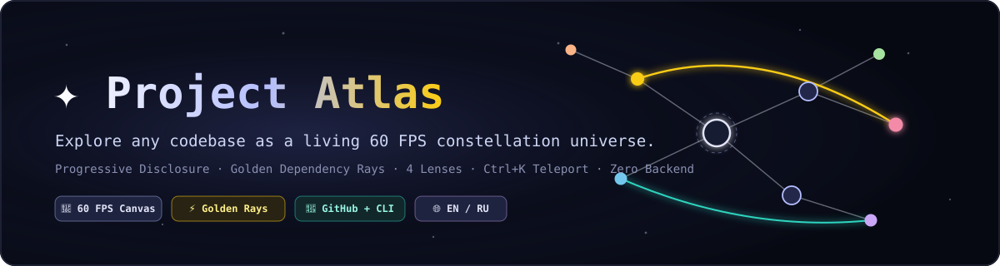
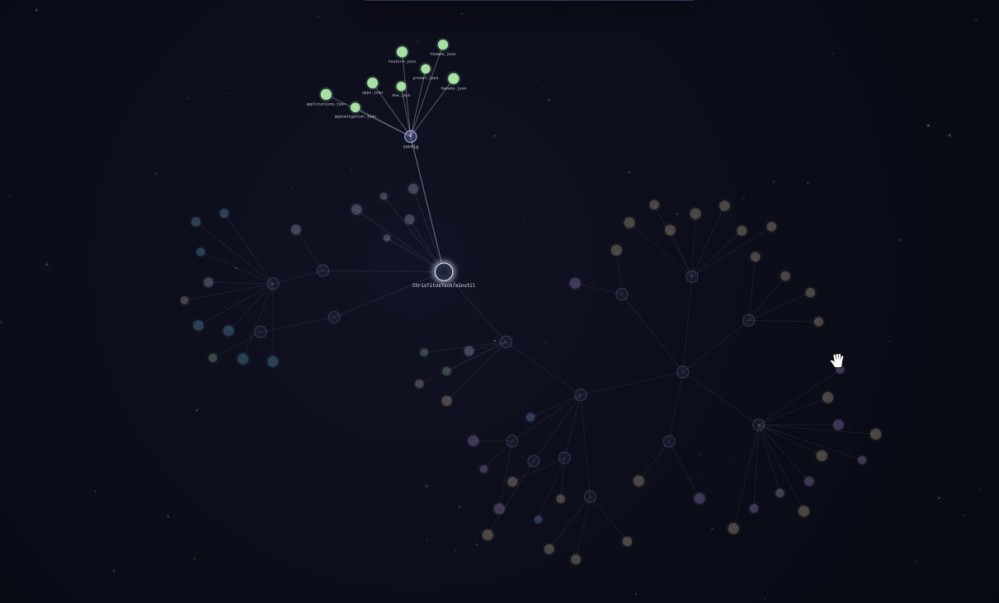

<p align="center">
  
</p>

<p align="center">
  <a href="https://goblin-inc.github.io/Project-Atlas/"></a>
  <a href="https://github.com/Goblin-Inc/Project-Atlas/releases/tag/v1.0.1"></a>
  
  
  <a href="LICENSE"></a>
</p>

<p align="center">
  <b><a href="https://goblin-inc.github.io/Project-Atlas/">🚀 Открыть живую демку</a></b> ·
  <a href="README.md">🇬🇧 English version</a> ·
  <a href="#-быстрый-старт">Быстрый старт</a> ·
  <a href="#-4-линзы-анализа-архитектуры">Линзы</a>
</p>

---

**Project Atlas** превращает любую локальную папку или публичный GitHub-репозиторий в живую **60 FPS вселенную созвездий** — чтобы разобраться в архитектуре чужого или своего проекта за **30 секунд**.

Вместо нечитаемого «клубка спагетти» из сотен пересекающихся узлов, Atlas открывает чистый корень проекта: ты плавно раскрываешь папки как созвездия, смотришь код и символы справа, а по одной кнопке зажигаешь **золотые анимированные лучи импортов и зависимостей**.

---

## 🖼️ Скриншот в действии

### Разбор крупного репозитория (`ChrisTitusTech/winutil` по ссылке GitHub)
> Активная ветка ярко подсвечена, а остальные созвездия мягко затемняются — никаких лагов и визуального шума.

<p align="center">
  
</p>

---

## ✨ Главные фишки

- **🌌 Постепенное раскрытие созвездий** — на старте только корень; клик по папке плавно раскрывает её созвездие с естественным звёздным разбросом, эффектом невесомости и авто-затемнением неактивных веток.
- **⚡ Режим золотых лучей зависимостей** — кликни на файл и нажми **«Показать импорты и зависимости»**: Atlas сам раскроет нужные папки, плавно кадрирует связанные узлы, приглушит всё лишнее и зажжёт **золотые лучи с бегущим импульсом** поверх белых структурных.
- **🔍 Телепорт (`Ctrl + K`)** — мгновенный поиск по всем файлам и папкам с автоматическим раскрытием пути и плавным перелётом камеры.
- **🐙 GitHub URL + Локальные папки + CLI** — загружай любой `owner/repo` прямо в браузере, открывай локальную папку без отправки на сервер или запускай `atlas .` из терминала (**ноль сторонних пакетов**).
- **🌐 Двуязычный интерфейс (`EN / RU`)** — автоопределение языка браузера + мгновенная кнопка `🌐 EN / RU` в верхней панели.
- **📸 Векторный экспорт в 1 клик** — **SVG**-снимок бесконечной чёткости (не ломается защитой Firefox от Canvas-фингерпринтинга) и экспорт графа в **Mermaid (`.mmd`)** сразу в буфер обмена.

---

## 🔭 4 линзы анализа архитектуры

| Линза | Что показывает |
|---|---|
| **🌌 Структура** | Чистая карта созвездий: папки и файлы, соединённые белыми структурными лучами. |
| **🔥 Влияние (Blast Radius)** | Клик на файл запускает BFS-волну (1-й / 2-й / 3-й уровень), показывая всё, что может затронуть его правка. |
| **🩺 Здоровье** | Считает **Health Score (0–100)** и подсвечивает циклы (красным), монолиты (оранжевым) и «сироты» без связей (пунктиром). |
| **🧭 Маршрут чтения** | Сам находит точку входа и нумерует рекомендованный путь изучения проекта (`1 → 2 → 3 → ...`). |

---

## 🚀 Быстрый старт

### Вариант 1 — Веб-версия без установки
Открой **[goblin-inc.github.io/Project-Atlas](https://goblin-inc.github.io/Project-Atlas/)** — прямо там работают встроенное **Демо**, выбор **локальной папки** и загрузка любого **GitHub-репозитория**.

### Вариант 2 — Локальный CLI (`atlas .`)
Нужен только **Python 3** (стандартная библиотека, никаких `pip install`):
```bash
git clone https://github.com/Goblin-Inc/Project-Atlas.git
cd Project-Atlas
./install.sh

# Запуск в любой папке проекта:
atlas .
# или с указанием пути:
atlas ~/Projects/my-app
```

---

## 🧠 Поддерживаемые языки (парсинг импортов и символов)
`Python` · `JavaScript / JSX` · `TypeScript / TSX` · `Java` · `C / C++` · `Rust` · `Go` · `Lua` · `HTML` · `CSS`

---

## ⌨️ Управление

| Действие | Управление |
|---|---|
| Раскрыть / свернуть папку | Клик по папке |
| Код, символы и связи файла | Клик по файлу |
| Золотые лучи связей + фокус камеры | Кнопка **⚡ Показать импорты и зависимости** |
| Телепорт к файлу / папке | `Ctrl + K` |
| Полёт / зум | Перетаскивание / Колёсико мыши |
| Сбросить линзу или режим связей | `Esc` |

---

## 📄 Лицензия
MIT © [Goblin-Inc](https://github.com/Goblin-Inc)
